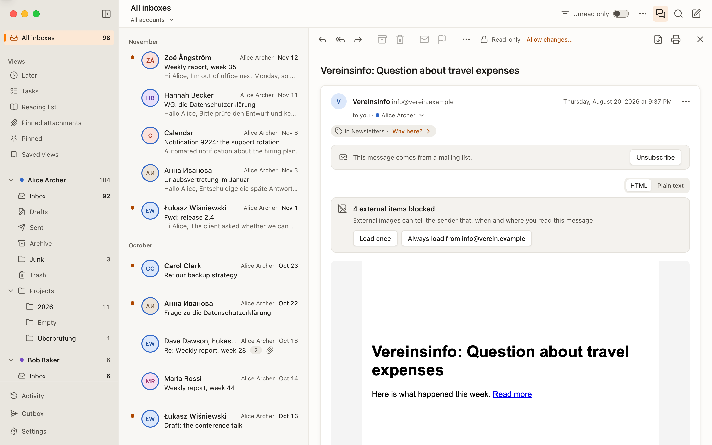
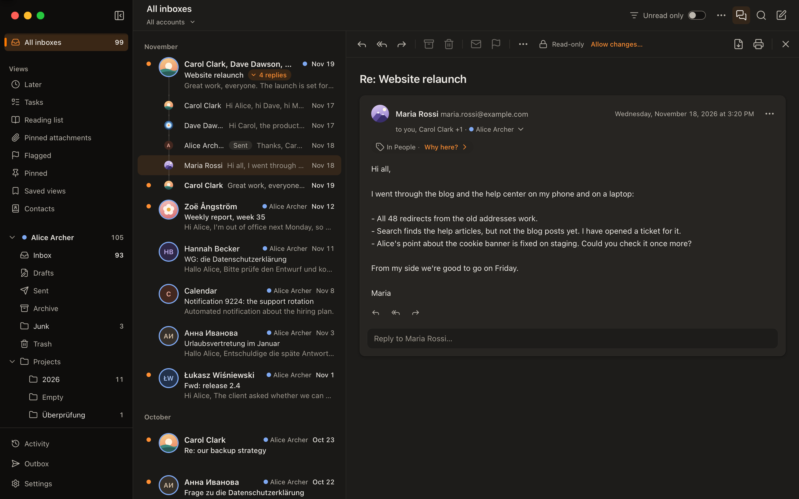
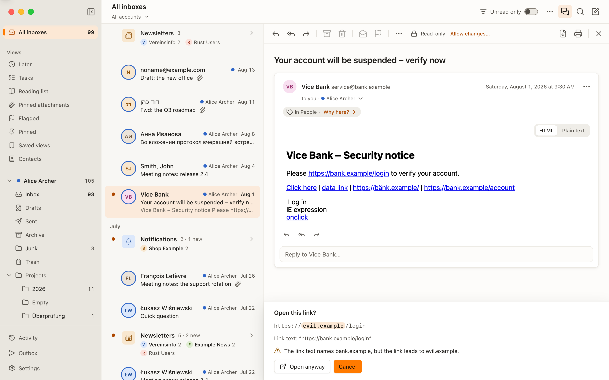
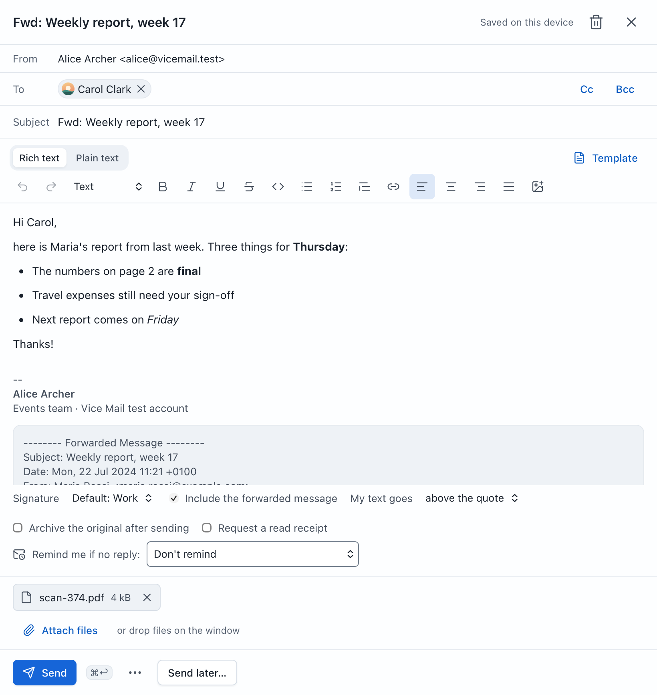
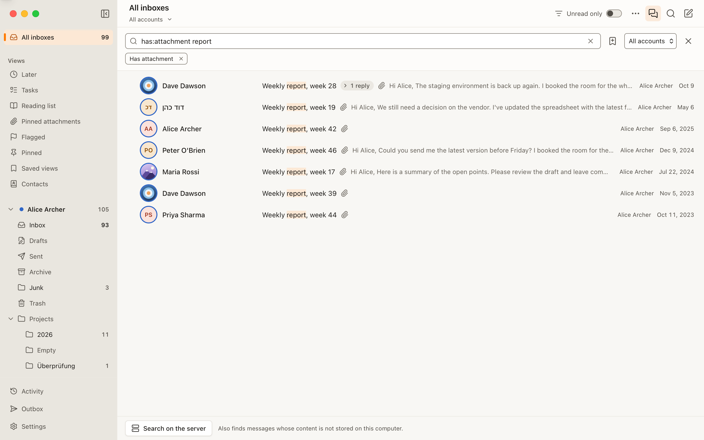
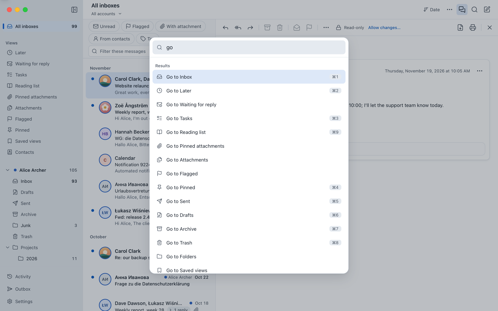
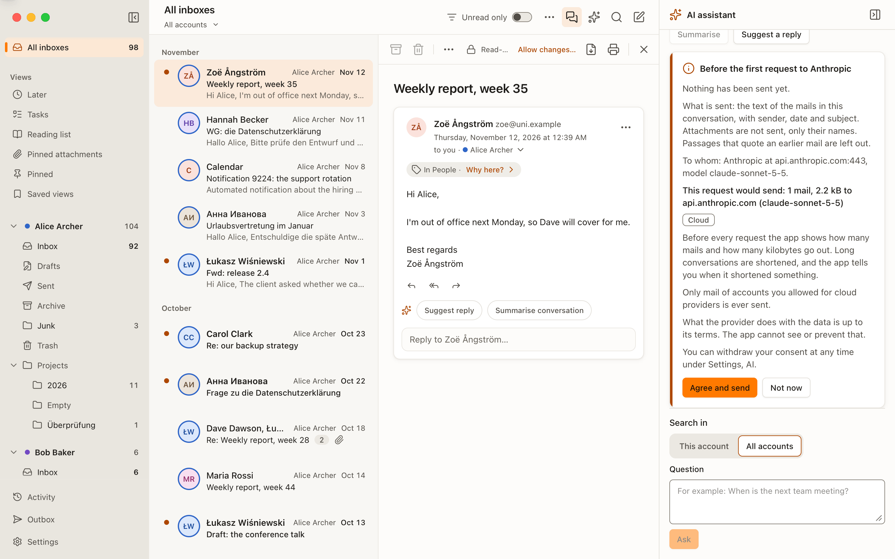
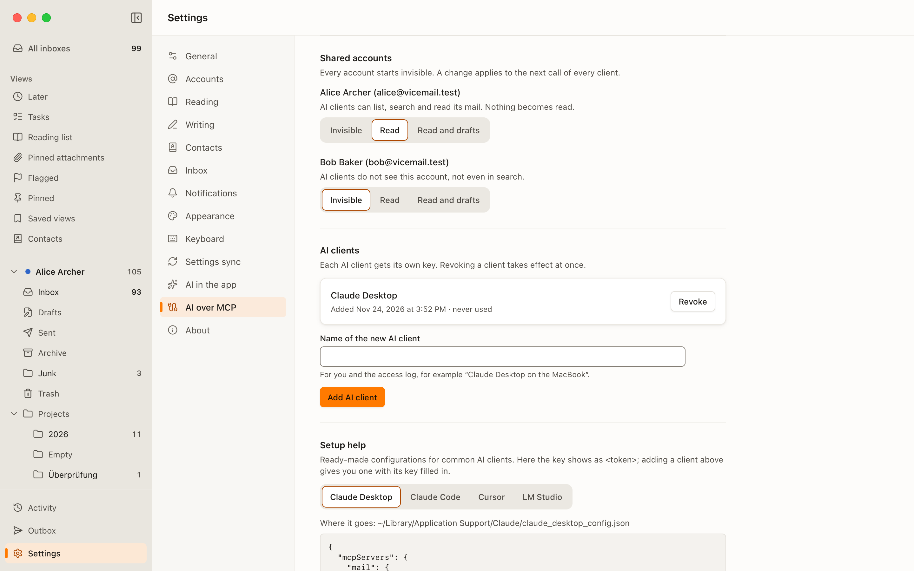

<p align="center">
  <picture>
    <source media="(prefers-color-scheme: dark)" srcset="docs/brand/wordmark-dark.svg">
    
  </picture>
</p>

# Vice Mail

An open-source email client for macOS and Windows: a Rust core, a React interface and
[Tauri 2](https://tauri.app) in between. It needs nothing but your own mail servers. There is no
cloud service of ours, no account with us and no telemetry.

> **Pre-alpha.** There is no stable release yet, data formats may still change, and the Windows
> build has not been tested on a Windows PC yet. Every account you add starts **read-only**: the
> app shows your mail but changes nothing on the server until you allow it for that account.

## Principles

1. **Fast.** Every basic action responds at once; the interface never waits for the network.
   The list stays smooth with hundreds of thousands of messages.
2. **Calm.** One line per message, little colour, no animation without a purpose.
3. **Private.** Remote content is blocked until you allow it. Nothing leaves your device without
   you asking for it. The full list of connections the app makes is in
   [docs/PRIVACY.md](docs/PRIVACY.md).
4. **Reliable.** No lost mail, no message sent twice, no silent failure. Every change goes through
   an outbox with a visible state.
5. **AI is optional.** Everything works without it. AI only makes suggestions and never acts on
   its own.

## Screenshots










<!-- docs/images/windows-inbox.png follows once the Windows build has been tested on a Windows PC
     (docs/images/README.md says how the screenshots are taken). -->

## Features

What exists today. See [CHANGELOG.md](CHANGELOG.md) for the details and what is still missing.

**Accounts.** Any IMAP/SMTP server, Gmail with an app password, and providers such as iCloud,
Fastmail or Posteo that use standard IMAP ([docs/PROVIDERS.md](docs/PROVIDERS.md) says which are
tested). Several accounts at once, each with its own colour. Server settings are found from the
address on request (DNS SRV and the domain's own autoconfiguration, no third-party directory).
JMAP servers with a password or an API token. Sign-in with Microsoft (Outlook.com, Microsoft 365)
and with Google is built in and tested against a local server; a build needs the project's own
client IDs for it, which the project has not registered yet. A short guided setup on the first start.

**Inbox.** A unified inbox across accounts, account groups, conversations (can be switched off),
categories without AI (people, notifications, newsletters, priority senders) with bundled rows,
pins, snooze, tasks, a reading list, a flagged view, favourite folders and folder colours,
creating, renaming and deleting folders, unread-only and unread-first views, local rules, blocking
senders, moving and copying between accounts.

**Reading.** HTML mail rendered through a sanitiser into a sandboxed frame with no scripts. Remote
images and tracking pixels are blocked until you allow them once or for a sender. Every link
shows its real target before it opens, with a warning when text and target differ. Images in
mail and attachment previews (images, PDF, text) are decoded in a separate helper process with
time and memory limits, so a crafted file cannot take the app down; saved attachments carry the
system's "downloaded" mark. Calendar invitations, one-click
unsubscribe, print and save as PDF, export and open `.eml` files, messages in their own window.

**Writing.** Rich text and plain text, several identities, signatures, templates (with
recipients), inline images, drafts saved locally and on the server (drafts from other programs
keep their images), undo send, send later, inline
quick reply, "send and archive", contacts from your own mail, read receipts only by the standard
(MDN, never without asking).

**Search.** Offline full-text search over everything stored locally, results while you type,
operators such as `from:`, `has:attachment`, `is:unread`, `before:`, saved and recent searches,
and continuing the search on the server.

**Settings sync.** Accounts (without passwords), identities, signatures, templates, rules and
settings are merged between your devices through a hidden folder in your own mailbox, encrypted
with a passphrase ([age](https://age-encryption.org)). No server of ours. A server change that
arrives from another device waits for your confirmation, so a stored password never follows it.

**AI, optional and off by default.**
- A local [MCP](https://modelcontextprotocol.io) server lets an AI client of your choice (Claude
  Desktop, Claude Code, Cursor, LM Studio, …) search and read the accounts you allow and create
  drafts. It cannot send, delete or move anything.
- AI in the app with a provider you choose: local (Ollama, LM Studio, any OpenAI-compatible
  server) or a cloud provider with your own API key. Summaries, reply suggestions, writing help,
  questions about your mail with sources, hints about unanswered mail. Before anything goes to a
  cloud provider the app shows what and how much.

**Everyday use.** Three layouts, full keyboard control with changeable shortcuts, a command
palette (Cmd+K / Ctrl+K), screen-reader labels, text size from 80 to 150 percent, light and dark
mode with six accent colours, native notifications, dock or taskbar badge, default mail app
(`mailto:`), English and German. "Export diagnostics…" writes a readable text file without
addresses, content or secrets, for bug reports.

**Updates.** The app can update itself from the GitHub releases, signed with the project's update
key. It only checks if you turn that on (off by default) or click "Check now".

## Install

There is no public release yet. Once there is, the files are on the
[releases page](https://github.com/othervice/vice-mail/releases).

| | Requirement |
|---|---|
| macOS | Apple silicon (M1 or later), macOS 11 or later. Intel Macs are not supported yet |
| Windows | Windows 11 on x64. Windows on Arm and Windows 10 are untested |

The Windows installer is not code-signed, so SmartScreen warns before the first start. macOS
builds are signed and notarised once the project's Apple developer membership is active; until
then Gatekeeper blocks them until you allow them once. The release notes say which kind a release
is. [docs/INSTALL.md](docs/INSTALL.md) explains each warning, how to check the download against
`SHA256SUMS`, where the app keeps its data and how to remove it completely.

## Build from source

The build machine is a Mac with Apple silicon. The Windows installer is cross-built on the same
Mac; building on Windows itself has not been tried. Linux is not supported yet.

| Tool | Version | Get it |
|---|---|---|
| Xcode or the Command Line Tools | current | App Store, or `xcode-select --install` |
| Homebrew | current | <https://brew.sh> |
| Rust (stable, via rustup) | at least 1.98, tested with 1.100 | <https://rustup.rs> |
| Node.js | 24 (tested 24.22) | `brew install node` |
| pnpm | 12 (tested 12.19) | `brew install pnpm` |
| cargo-deny | current | `cargo install --locked cargo-deny` (for `scripts/check.sh`) |
| Python 3, standard library only | tested 3.15 | with Xcode or Homebrew (for the test mail server) |
| For the Windows installer: LLVM, NSIS, cargo-xwin, Rust target `x86_64-pc-windows-msvc` | LLVM 23.1, NSIS 3.13, cargo-xwin 0.24 | `brew install llvm nsis`, `cargo install --locked cargo-xwin`, `rustup target add x86_64-pc-windows-msvc` |

```sh
git clone https://github.com/othervice/vice-mail.git
cd vice-mail
pnpm --dir app install --frozen-lockfile

pnpm --dir app tauri dev          # run the app in development mode
scripts/check.sh                  # format, lint, all tests, type check, licence and advisory checks
scripts/build-macos.sh            # .app and .dmg for Apple silicon (ad-hoc signed)
scripts/build-windows.sh          # Windows installer, cross-built
scripts/release-local.sh          # both, plus SHA256SUMS, into dist/<version>/
```

[docs/SETUP.md](docs/SETUP.md) has every step in detail, including a known NSIS crash without a
UTF-8 locale and why macOS builds made over SSH need `CI=true`. Building and publishing a signed
release is described in [docs/RELEASING.md](docs/RELEASING.md).

### Tests against a local mail server

Integration tests never touch a real mailbox. They run against a local
[Stalwart](https://github.com/stalwartlabs/stalwart) server that listens only on `127.0.0.1` and
is downloaded on first use with a pinned checksum (a development tool, not shipped with the app):

```sh
scripts/testmail.sh reset && scripts/testmail.sh start && scripts/testmail.sh seed 1000
```

Desktop tests drive the real app through WebDriver and need a logged-in GUI session:
`pnpm --dir app test:e2e`. See [testmail/README.md](testmail/README.md) and
[CONTRIBUTING.md](CONTRIBUTING.md).

## Documentation

| File | Content |
|---|---|
| [docs/INSTALL.md](docs/INSTALL.md) | installing, Gatekeeper and SmartScreen, data locations, uninstalling |
| [docs/PRIVACY.md](docs/PRIVACY.md) | every connection the app makes, what is stored where |
| [docs/PROVIDERS.md](docs/PROVIDERS.md) | what works with which mail provider |
| [docs/SYNC.md](docs/SYNC.md) | the settings sync format and what the mail server can see |
| [docs/SETUP.md](docs/SETUP.md) | setting up a development machine |
| [docs/RELEASING.md](docs/RELEASING.md) | building, signing and publishing a release |
| [docs/ARCHITECTURE.md](docs/ARCHITECTURE.md) | stack, module boundaries, mail engine rules, security boundaries |
| [docs/README.md](docs/README.md) | how the `docs/` folder is organised, including the project log |

The project was planned and built in stages. Plans, stage reports and recorded decisions are kept
as a project log in German; [docs/README.md](docs/README.md) explains the structure.

## Contributing and security

Contributions are welcome; start with [CONTRIBUTING.md](CONTRIBUTING.md). Please report security
problems privately as described in [SECURITY.md](SECURITY.md), not in a public issue.

## Licence

Vice Mail is free software under the GNU General Public License, version 3 or (at your option)
any later version (GPL-3.0-or-later). See [LICENSE](LICENSE). Third-party libraries keep their own
licences; `scripts/check.sh` checks that they are compatible (`cargo deny`).

"Vice Mail" and its logo ([docs/brand/](docs/brand/README.md)) identify this project.
